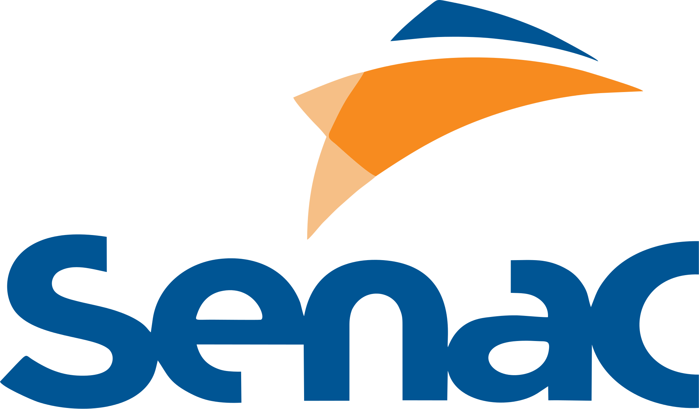

<!-- ===================== CABEÇALHO ===================== -->

  

---

## 👨‍🎓 Sobre mim

Sou **mineiro**, tenho **20 anos** e sou apaixonado por tecnologia. Depois de passar pelo **Colégio Tiradentes**, mergulhei na **Ciência da Computação na UNIPAC**. O que começou como curiosidade virou um interesse real, que só cresce a cada nova possibilidade que descubro na área.

Hoje meu foco é **desenvolvimento backend**, com **Python** e **integração com IA** para construir ferramentas que realmente ajudam as pessoas.

---

## 📱 Contato

  
  
  

  
  

---

## 🛠️ Tecnologias e ferramentas

**Linguagens e Frontend** 

**Banco de Dados** 

**Contêineres e DevOps** 

**Versionamento e IDEs** 

**Inteligência Artificial** 

**Hardware / Software** 

---

## 🚀 Projetos

<table>
  <tr>
    <td width="50%" valign="top">
      <h3>📈 <a href="https://github.com/arthurandriws-ctrl/Analise-Perfil-Financeiro">PsicoFinanças</a></h3>
      <b>Projeto em equipe</b> · 
        
      
      
      
      
        
      <b>Objetivos:</b>
      <ul>
        <li>Diagnosticar o perfil financeiro</li>
        <li>Propor dicas e estatísticas</li>
        <li>Oferecer conteúdo para o amadurecimento econômico</li>
      </ul>
      
    </td>
    <td width="50%" valign="top">
      <h3>📺 <a href="https://github.com/arthurandriws-ctrl/LibraryVid">LibraryVid</a></h3>
      
        
      
      
      
        
      <b>Funcionalidades:</b>
      <ul>
        <li>Armazenar, organizar e recomendar conteúdo informativo</li>
        <li>Tornar o lazer de fácil acesso e compartilhável</li>
        <li>Aprofundar o conteúdo armazenado</li>
        <li>Sistema de avaliação personalizado</li>
      </ul>
      <!-- Adicione um print:  -->
    </td>
  </tr>
  <tr>
    <td colspan="2" valign="top">
      <h3>🕵️‍♂️ <a href="https://github.com/arthurandriws-ctrl/Analista-de-URLs/blob/main/README.md">Analista de URLs</a></h3>
      
      
        
      <b>Objetivos:</b>
      <ul>
        <li><b>Dados não estruturados:</b> automatizar a extração e o tratamento de metadados</li>
        <li><b>Síntese inteligente</b> de informação</li>
        <li><b>Fluxo de trabalho:</b> transformar o consumo passivo de vídeo em material de estudo</li>
      </ul>
    </td>
  </tr>
</table>

---

## 📊 Estatísticas

  
    
  
  

---

## 🔎 Curiosidade sobre mim

No ensino médio, desenvolvi um forte interesse por **física teórica**: participei da **OBFEP** (Olimpíada Brasileira de Física das Escolas Públicas) e cheguei à segunda fase na **EPCAR**.

Temas como **radiação, fusão e fissão nuclear** sempre me chamaram a atenção, e até hoje mantenho uma rotina de estudos sobre o funcionamento de centrais nucleares e a análise de eventos históricos, como os acidentes de **Fukushima** e **Chernobyl**.

Em uma visita técnica promovida pelo Colégio Tiradentes, conheci a **Usina Angra 1**, em Angra dos Reis (RJ), onde pude observar a complexidade da operação e o compromisso com a preservação das zonas ambientais do entorno.

<b>📸 Registro da visita técnica: Usina Nuclear Angra 1</b>

 

  

---

> *"Sometimes it is the people no one imagines anything of who do the things that no one can imagine."*
> **— Alan Turing**

 

